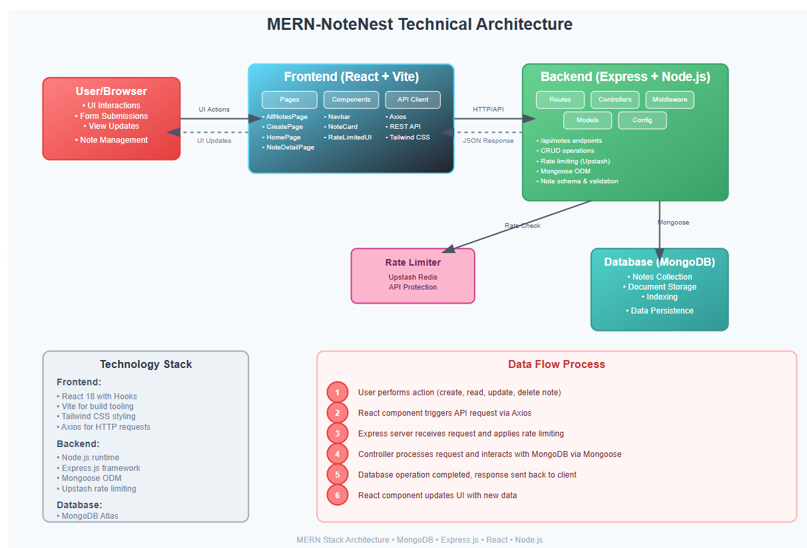

# NoteNest

A full-stack note-taking application built with the MERN stack (MongoDB, Express.js, React, Node.js) featuring rate limiting and a modern frontend.

---

## Features

- Create, read, update, and delete notes
- User-friendly React frontend with Tailwind CSS
- RESTful API backend with Express.js
- MongoDB for persistent storage
- Rate limiting middleware to prevent abuse

---

## Project Structure

```
MERN-NoteNest/
├── backend/
│   ├── src/
│   │   ├── config/
│   │   ├── controllers/
│   │   ├── middleware/
│   │   ├── models/
│   │   ├── routes/
│   │   └── server.js
│   └── package.json
├── frontend/
│   ├── src/
│   │   ├── components/
│   │   ├── lib/
│   │   ├── pages/
│   │   ├── App.jsx
│   │   ├── index.css
│   │   └── main.jsx
│   ├── public/
│   ├── package.json
│   └── ...
├── package.json
├── technical_architecture.md
└── README.md
```

---

## Architecture Diagram



---

## Getting Started

### Prerequisites

- Node.js (v18+ recommended)
- MongoDB instance (local or cloud)

### Backend Setup

1. Navigate to the backend folder:
   ```bash
   cd backend
   ```
2. Install dependencies:
   ```bash
   npm install
   ```
3. Configure environment variables (MongoDB URI, Upstash credentials, etc.)
4. Start the backend server:
   ```bash
   npm start
   ```

### Frontend Setup

1. Navigate to the frontend folder:
   ```bash
   cd frontend
   ```
2. Install dependencies:
   ```bash
   npm install
   ```
3. Start the frontend development server:
   ```bash
   npm run dev
   ```

---

## API Endpoints

- `GET /api/notes` - List all notes
- `POST /api/notes` - Create a new note
- `GET /api/notes/:id` - Get a note by ID
- `PUT /api/notes/:id` - Update a note
- `DELETE /api/notes/:id` - Delete a note

---

## License

MIT
